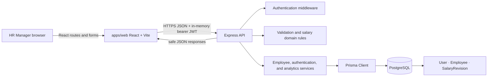
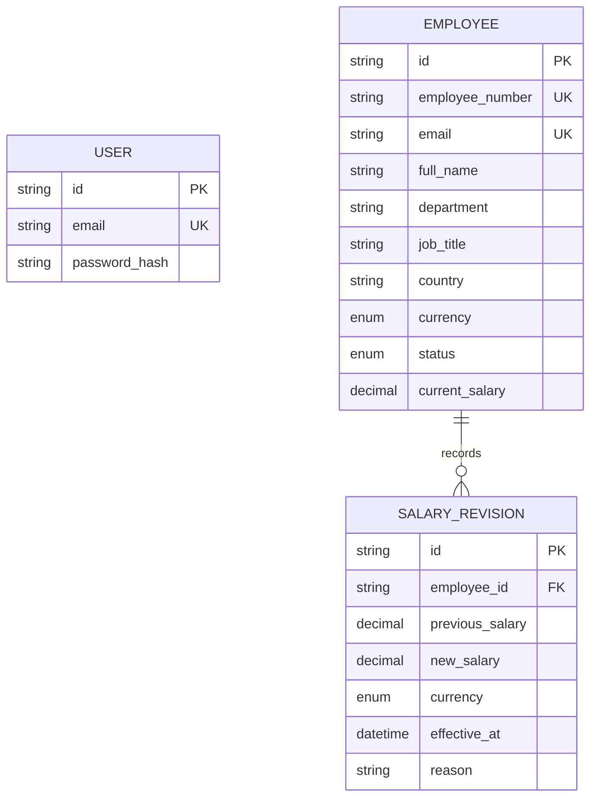

# Architecture

## System and request flow

1. The React application in `apps/web/src/App.tsx` routes signed-in users through the workspace shell. `apps/web/src/auth.tsx` holds the short-lived access token in component memory; it is not persisted in local or session storage.
2. `apps/web/src/api.ts` sends JSON requests to `VITE_API_BASE_URL` and adds the bearer token. The API validates the token in `apps/api/src/middleware/auth.ts`.
3. Express routes in `apps/api/src/app.ts` validate request bodies and query parameters with Zod schemas before calling operations in `apps/api/src/services/`.
4. Services use the generated Prisma client to query PostgreSQL. Prisma transactions keep an employee salary and its revision consistent.
5. Responses are JSON. Safe API errors use a stable `{ error: { code, message } }` envelope.

## Components and responsibilities

- **Web (`apps/web`)**: TypeScript, React, Vite, React Router, Tailwind CSS utilities and Recharts. `pages.tsx` contains dashboard, directory, profile/history, and analytics views. `api.ts` owns the HTTP boundary and employee/analytics response types.
- **API (`apps/api/src/app.ts`)**: Express middleware, public health/sign-in endpoints, authenticated HR endpoints, validation, and safe error mapping. `server.ts` owns the Node HTTP listener and graceful shutdown.
- **Domain (`apps/api/src/domain`)**: Employee write schemas and decimal-safe currency validation/distribution helpers. Supported currencies and their minor-unit precision are explicit.
- **Services (`apps/api/src/services`)**: Authentication, paginated employee reads/creates/edits/salary revisions, and analytics query orchestration.
- **Persistence (`apps/api/prisma`)**: PostgreSQL schema, hand-maintained initial migration, local HR provisioning command, and deterministic synthetic-data seed.

## Data model

`Employee` is retained with `ACTIVE`/`INACTIVE` status instead of hard-deletion. `SalaryRevision` rows are append-only through the application API; an employee's first salary creates a revision with no previous value. On salary change, `services/employee.ts:updateSalary` reads the current record, validates matching currency/no-op conditions, updates the employee, and appends history in one serializable transaction. The database additionally constrains positive salary and prevents deleting referenced employees.

Monetary inputs and persisted `NUMERIC(19,4)` values are decimal strings. The API supports USD, EUR, GBP, INR, CAD, AUD, SGD (2 fraction digits), JPY (0), and BHD (3). Analytics keep currencies separate. PostgreSQL provides min/max/average aggregates, and `domain/salary.ts:salaryDistribution` calculates medians and within-currency quartile bands using scaled `bigint` arithmetic; medians round half-up to the currency precision.

## Key decisions

- **Modular monolith**: one Express process and one relational database keep the assessment deployable and easy to reason about. Feature boundaries are kept in route, domain, and service modules; there is no premature distributed infrastructure.
- **PostgreSQL + Prisma**: the employee/history relationship and atomicity are relational. Prisma covers ordinary CRUD and typed aggregation; database constraints, migration SQL, and query shape still require engineering attention.
- **Bearer token held in memory**: a one-hour signed token is sent in the `Authorization` header and not stored persistently. This avoids browser token persistence and ambient-cookie CSRF behavior, at the cost of requiring sign-in again after refresh and lacking revocation until token expiry.
- **No conversion**: salary aggregates and department/country averages are grouped by currency, rather than implying an exchange-rate source/date that has not been specified. Country headcounts combine counts only; the salary tables keep country/currency pairs distinct.
- **Server-side pagination**: a page is limited to 100 rows and sorted only on an explicit field allowlist. The list/count execute together; indexes support common status/location filtering and salary-history lookup.
- **No Vercel API fork**: Vercel hosts the static frontend; it calls the same standard Node API hosted on Render or another persistent Node host. That avoids an untested second API adapter.
